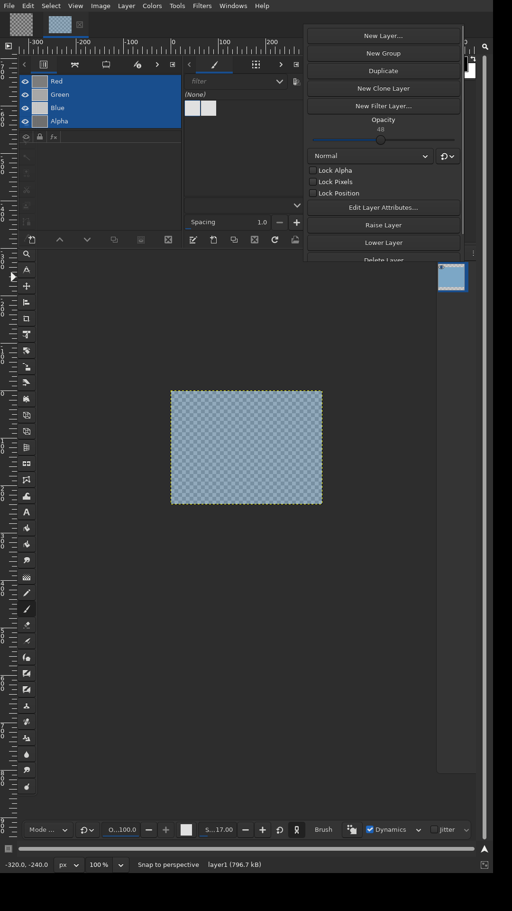

# Common layer native popup reconstruction

**DONE for the bounded common-layer native-popup leaf — run18 passed the
complete focused native acceptance at both portrait scales.** Broader parent,
old-runtime visual, cross-platform and sanitizer obligations remain open.

Base source: `d4ce384f708090facbf6b08edc38b4ddcf84cff0` (published task306).
Old source: `afa43fae3e920210146abed514f136fd49f671b5` (gimp-painter 2.8).
This is newly reconstructed source, not recovered unpublished task307 output.
No prior task307 pass or screenshot is evidence for this candidate.

See `../../contracts/common-layer-native-popups.md` for the bounded carrier,
consumed-outside/live-edit/Undo, placement and lifetime contract.

## Accepted final-source evidence

[Run 40198528473](https://github.com/seagetch/gimp-painter/actions/runs/40198528473)
accepted source `d6d3126cc7ca5b7cb71ff48212cc6639f50bc145` with all seventeen
compiler-input hashes from manifest
`04b3053c24509ad643b6782197bd80abcf5a74582c3e474500a01323e2c87e9f` unchanged.
The exact source-manifest file remains the tested pre-acceptance snapshot;
its historical DOING field is preserved to keep native-build/CI hash references
valid. Final acceptance is recorded here, in the contract and scoped WBS row.
The acceptance is scoped to this leaf and the stated native Linux fixture:

- Common property routes: **58/58 at scale1 and 58/58 at scale2**, no skipped
  expected IDs, real XTest entry/dismissal and strict geometry/model/Undo,
  provenance, lifetime and reentry checks.
- Separate owned-offscreen gate: **6/6 at each scale**, real new native page
  insertion and current-label allocation before exact native child-window draw,
  eventual paint, old-clock teardown, late invalidation, redraw-only token
  balance and fresh remap witness.
- Adjacent regressions: **13 registrations / 360 cases**, including Filter,
  layer UI/tree, canvas, native docks, handles, dispatch and exception contracts.
- Portrait evidence: all **16 raw 1080×1920 PNGs** at scales1/2, individually
  inspected, with default-oncanvas single-window fixture, real lower-control
  scrolling/reachability and genuine live edits. The fixture includes its
  keeper tab, minimal test resources and portrait status clipping; this is not full installed-startup or
  old2.8 pixel equivalence. The expanded scrollbar can overlay some right-edge
  value pixels; lower-action and route-specific bottom controls are reachable.
- Genuine header checks (453 C/C++ probes), 361 catalog verification, empty
  generated source delta and exact source integrity passed. Native014 records
  the final focused-test relink with zero warnings and unchanged seventeen
  hashes; the earlier full native013 build is retained with its warning detail.
- All four pinned306 probes reached the intended carrier rejection. The
  separate immutable historical controlled-order diagnostic again reproduced
  its expected warning/SIGTRAP inside the existing-update helper. Those RED
  controls are not counted as positive candidate test cases.

Every focused insertion recorded one actual page-added event, no prior tab
allocation/native draw at the tested boundary, and a held gate. Subsequent
native drawing used the exact retained OFFSCREEN window with a current-label
allocation witness and prior logical layout/after-paint. No unallocated native
draw was observed. Redraw-only allocation counts stayed 13→13 at scale1 and
16→16 at scale2 while the independent freeze token remained respected.

This qualifies the bounded correction; it does **not** prove the natural
attempt14 failure had exactly the imposed diagnostic order, identify run17's
unrecorded failed conjunction component, or establish universal GTK allocation
readiness. The existing documented gate limits and historical failed attempts
remain intact. No warning, timeout, native-input or screenshot gate was waived.

## Historical reconstruction and validation evidence

The sections below preserve the state and limitations at each earlier attempt;
statements that a rerun was pending are historical, not the current status.

- The four production files were inspected against the pinned old/current
  sources and independently reviewed for staged assembly and lifecycle guards.
- Their three C++ translation units passed C++14 syntax-only compilation against
  the restored dependency environment and generated task306 configuration.
- Seven changed test translation units passed C11/C++14 syntax-only compilation.
  The later single-window fixture correction was separately rechecked as C++14.
- `git diff --check` passed on the reviewed candidate.
- The source manifest records exact file digests. Syntax-only success is **not**
  a linker result or a native GTK, XTest, sanitizer, screenshot or aggregate pass.
- An earlier, now-superseded candidate completed normal native compilation/link
  and both display-independent header-archive checks. It predates final scope,
  provenance and fixture corrections and is not final-source validation. The final reviewed delta then passed normal incremental compilation/link
  (application plus six UI executables), both genuine header archives and two
  display-independent verification registrations. All 13 reviewed source hashes
  remained unchanged and the generated-source delta was empty. See
  `native-build-002.json`; its nonfatal test indentation warning is retained.
  This does not establish any native GUI result.
- The local AF_UNIX capability limit still blocks a normal local display
  session. Separately authorized native CI has now exercised the published
  candidate; its incomplete/failing result is recorded below, not a skip pass.

### Native CI attempt 6: incomplete, not acceptance

[Run 40167140576](https://github.com/seagetch/gimp-painter/actions/runs/40167140576)
tested published commit `c4405e72a40950ba26428e04c771e226376e8e55`.
Both jobs failed their final gates. The production files are unchanged by the
subsequent diagnostic harness revision.

- Candidate: twelve adjacent registrations passed (328 cases). The thirteenth,
  `layer-tile-entry-contracts`, passed 31 cases then failed the native-carrier
  assertion in `cpp/both-canvas-action-isolation`.
- Common scale 1: the two group-context cases passed. Ordinary-tile actual
  entry opened, edited opacity and wrote one genuine 1080×1920 PNG, then failed
  because a GTK grab remained after outside dismissal. The old host had been
  unrealized. The remaining grab's identity/event sequence was not recorded;
  this is not yet proof of a particular production cause.
- Common scale 2: the first group-tile case did not capture a popup. Actual
  root hit coordinates and event destinations were not recorded. No complete
  scale-2 screenshot evidence exists.
- Baseline: all four probes failed to capture a popup, rather than reaching
  the required `GTK_IS_WINDOW` carrier assertion. The strict RED validator
  correctly rejected these failures. GTK can realize a parented GtkPopover
  inside its factory, before production assigns the name: the realize-only
  observer was insufficient for this control.
- Native builds, header verification, locale verification and source-integrity
  checks completed, but do not turn these GUI failures into acceptance.

The revised harness retains the strict carrier, geometry, timing, input and
model assertions. It adds an exact-name map capture fallback without replacing
the native host's earlier realize-time geometry. The inherited two-canvas
isolation case now uses native multi-window mode only within that case, so
both opposite-context owners remain mapped; all model/Undo assertions remain
and the prior mode is restored. The common matrix still requires the default
single-window, on-canvas UI.

`GIMP_TEST_COMMON_POPUP_DIAGNOSTICS` enables bounded, buffered event/host and
requested-versus-actual pointer geometry traces, flushed only at the diagnosed
failure assertions. Failure-root PNGs go into a separate diagnostic directory,
never the four-PNG-per-scale acceptance directories. They are failed-state
evidence, not positive screenshots. This revised harness has syntax-only
verification; its native rerun is pending. No production workaround for the
outside-dismissal or scale-2 failure has been applied without that evidence.

### Native CI attempt 7: valid RED control, candidate input missed its target

[Run 40169528288](https://github.com/seagetch/gimp-painter/actions/runs/40169528288)
tested commit `4a1daeae3a5cfbcae6c649fd6e6dfdc7f321f2f5` with the revised
capture/diagnostic harness. All four baseline probes reached the intended
`GTK_IS_WINDOW` assertion and passed the strict RED gate. This proves the
carrier control, not baseline UI acceptance. All thirteen adjacent candidate
registrations passed (360 cases), including the corrected two-canvas fixture.

Neither common scale completed its first group-tile case. The failed-state
PNGs and event traces establish wrong-target delivery: scale 1 requested
physical `(616,235)`, hit the brush GtkIconView and opened its menu; scale 2
requested `(1232,470)` beyond the 1080-pixel screen, then hit the canvas after
pointer clamping. The layer anchor was sampled at height 332 while the later
scale-1 image shows the fully extended right rail. The baseline's successful
tile input instead sampled height 1075 and hit `(952,584)` on the intended
drawing area. There are no acceptance PNGs or completed common cases for this
candidate run. Attempt 6's partial result remains historical, not reused.

GTK 3.24.49's [`gtk_widget_translate_coordinates()`](https://github.com/GNOME/gtk/blob/3.24.49/gtk/gtkwidget.c#L6060-L6075) follows effective GdkWindow
parents through the offscreen `to-embedder` transform. Thus the API is not
inherently missing the overlay transform. The native canvas also intentionally
defers overlay positioning/allocation after resize. The observed geometry and
mis-hit justify a readiness correction, not guessed coordinates or a display
size change.

The next harness revision waits for three stable after-paint geometry
observations, bounded by three seconds, before each fixture's first opening.
It compares GTK-translated and GdkWindow root coordinates plus allocations,
then recomputes the tree row area. Each real motion is remeasured; at most one
re-motion follows an observed target movement. A button press requires an
in-screen point and an actual hit on the requested widget or its descendant.
Failure retains diagnostics rather than pressing an unrelated control.
Subsequent rapid opens add no frame wait; the original interval and observed
classified-event assertions remain mandatory. Each existing rapid case also
retains its original checks and adds a separately reset fast opening/outside
pair, requiring an actually observed double/triple classification inside the
configured interval and no remaining host/grab after dismissal. This prevents
readiness work from concealing the earlier closing-companion failure by merely
slowing the click. Production code, all 46 cases,
strict geometry and screenshot/RED gates are unchanged. Syntax-only checking
passed; native validation of this readiness revision is pending.

### Native CI attempt 8: real target reached; closing companion reopened a host

[Run 40172232500](https://github.com/seagetch/gimp-painter/actions/runs/40172232500)
tested `9e96cf561432c1b99c27cc2a924e311c0314783f`. Both scales passed their two
group cases and reached the intended ordinary tile. Scale 1 hit `(952,584)`;
scale 2 hit logical `(488,488)`, physical `(976,976)`. Readiness, both root
coordinate methods, screen bounds and actual hit-widget assertions passed.
All thirteen adjacent registrations passed (360 cases); all four baseline
carrier RED probes and header checks passed.

Ordinary-tile actual entry produced a genuine opacity-edited PNG at each scale,
but neither full case passed. At scale 1 time `539077`, the normal outside
button-3 press reached the old native host and unmapped it. A same-time,
same-window/device/root `GDK_3BUTTON_PRESS` then reached the uncovered tile
and mapped a **new** GimpPopover2 with a new grab. Scale 2 recorded the same
sequence at time `550370`. The failure PNGs show the new host at the
Undo-restored opacity 49, versus 48 in the earlier edited captures. This is a
proven second activation, not a stale old grab. These partial captures are not
the complete passing eight-image acceptance set.

The next production revision records exact one-shot closing provenance only
for the common tile host's own list/add receiver, buttons1/3. Cancel emission
stages the copied event; matching current-event destruction confirms it. The
receiver consumes only that exact classified counterpart before side effects.
Unmatched input and Filter/creation own opening policies remain unchanged.
This is a qualified GTK3 correction, not literal old2.8 type filtering or a
cross-owner/global companion guarantee. The deterministic handler probes use
`gtk_main_do_event` to establish GTK's current-event stack, including vetoed
cancellation then unrelated destruction; direct receiver mismatches are not
misrepresented as physical input.

Physical outside checks retain identities of previously mapped toplevels and
observe subsequent map signals, rejecting newly mapped dialogs even if they
close again or have no grab. Only the exact `GtkTooltipWindow` runtime type
**and** TOOLTIP window hint are exempt. Original real classified-event/timing
checks remain mandatory. Four additional actual-input lower-control cases
produce eight bottom-view captures across the scales. Tile cases require real
scrollbar wheel input to the bottom and physical All Layer Actions activation;
tree cases exercise their actual shorter form's last Alpha or Clone Source
control, not nonexistent tile-only actions. These changes bring the plan to
54 cases and 16 raw images. Syntax checking passed; native execution of this
revision remains pending and does not close the task.

### Native CI attempt 9: ordinary tile closes; lower input fails window viewability

[Run 40175112005](https://github.com/seagetch/gimp-painter/actions/runs/40175112005)
tested `d5c68afde28d127763584224cedeb812f6b9ff84`. All four baseline controls
reached their intended native-carrier rejection; all 13 adjacent registrations
(360 cases) and header checks passed. Both common scales passed the two group
cases **and the full ordinary-tile actual-entry case**, including outside
closure. The next lower-controls case failed the input helper's native-window
viewability precondition before any lower-view capture. That early assertion
did not emit the failing widget identity; the scrollbar diagnosis below is
source-based, not an observed widget trace. Only the two
original ordinary-tile images exist; there is no bottom-view or full-suite
acceptance from this run. The earlier closing defect is no longer observed in
this actual-entry path, but remaining provenance/rapid routes were not reached.

GTK 3.24.49's [scrolled-window implementation](https://raw.githubusercontent.com/GNOME/gtk/3.24.49/gtk/gtkscrolledwindow.c)
intentionally hides an overlay scrollbar's parent indicator window even while
the scrollbar widget is mapped. Native mouse motion over scroller content
requests its reveal. The test-only revision therefore physically hovers the
visible New Layer button without clicking, waits at most two seconds for the
actual scrollbar window to become viewable, then retains the original strict
wheel/hit, scrolling, lower-control bounds and activation assertions. It does
not disable overlays, set adjustments or directly show a window. The extracted
aiming path preserves existing click motion/flush cadence and rapid timing;
early input preconditions now record safe widget/window state and failure PNGs.
This revision is syntax-checked, not yet natively executed.

### Native CI attempt 10: multiple independent failures, bounded partial evidence

[Run 40176782833](https://github.com/seagetch/gimp-painter/actions/runs/40176782833)
tested `978461dde961ee6f11067b8f9c68085bc442a600`. Baseline's four strict RED
controls, the 13 adjacent registrations/360 cases and header gates passed.
The full scale1 common run passed three cases, then failed lower-control
readiness while the revealed scrollbar expanded: width 6→8→14, sampled root
x 976→974→968. The full scale2 run passed 13 cases, including physical lower
scroll/All Actions, mode growth, rapid classified closure and tile exact/mismatch
provenance, then exited with SIGSEGV after the staged-child-0 PASS. There is no
stack or next-case start marker proving the fault location.

Supplementary scale1 route-prefix diagnostics are **not acceptance substitutes**:
both tile routes passed actual-entry then reproduced the scrollbar expansion
failure; both tree routes passed seven cases then failed classified outside
closure by mapping a secondary dialog with no grab. Raw failure images identify
Edit Layer Attributes for ordinary and Clone Source for Clone. Normal close and
same-source double classification share the timestamp in each tree trace. Only
three acceptance-directory images exist (ordinary tile upper at both scales
and bottom at scale2), not the complete 16-image set.

The next revision preserves generic/rapid input timing and the strict geometry
oracle. Only lower scrolling adds real motion onto the revealed scrollbar and
three stable after-paint observations under the existing bound before the
unchanged exact-hit/wheel path. The tree adds same-owner confirmed closing
provenance before native row activation, with four targeted exact/mismatch
cases; the original failing physical rapid oracle remains. A minimal Canvas
parented-owner guard addresses a source-demonstrated setter call on a retained
but destroyed editor. This is not yet a proven explanation of the SIGSEGV;
old-source stack diagnostics remain required. All destructive tests remain.
The resulting plan is 58 cases/16 images, with native execution pending.

### Native CI attempt 11: destructive tile routes pass; two test observation gates remain

[Run 40178769191](https://github.com/seagetch/gimp-painter/actions/runs/40178769191)
tested `1a7b273de263b158db3382228dd7b59028c58d13`. Full scale1 passed 37/58
cases, including both tile routes and every tile staged-child destruction case,
then stopped at ordinary-tree rapid closure because the recorded classified
count was zero. The old host was gone, no grab remained and the failure image
showed no secondary dialog. The observer was still attached to the later
button-press signal, which the new early tree event handler can correctly
prevent. The test revision observes generic event emission with an explicit
normal/double/triple button-type guard; it does not remove the required real
classification, timing or no-new-window assertions.

Full scale2 passed three cases, then strict lower-control geometry failed.
The initial stable frames still showed width6; a subsequent hover began the
6→11→14 transition. Scrollbar preparation now requires a real bar hit and the
GTK overlay indicator's hovering class before its existing stable-frame wait.
Traditional non-overlay scrollbars have no such class requirement. No settings,
geometry equality, generic click cadence or rapid timings are changed.

The four supplementary prefixes remain diagnostic-only: tile prefixes passed
14 cases each; tree prefixes passed seven then reproduced the observer failure.
Adjacent registrations (13/360 cases), catalogs and headers passed. Seven
acceptance-directory PNGs exist (six scale1 and one scale2), not sixteen.

The separately pinned historical `978461…` staged-child-1 scale2 GDB probe
reached Fixture destruction → display deletion/image notification → Canvas
reconnect/show:361 → a fatal GObject property critical. This runtime-demonstrates
the stale-editor path addressed by the parented-owner guard. Its stop was
**SIGTRAP**, not attempt10's SIGSEGV: the strict historical SIGSEGV diagnostic
remains failed, and identical signal reproduction is not claimed. The current
candidate's scale1 destructive tests passed unchanged; scale2 did not reach
them in this run. Final 58-case/16-image acceptance remains pending.

## Registered acceptance plan

`painter-common-layer-popup` selects the common-host branch of
`test-painter-layer-ui` with `GIMP_TEST_COMMON_LAYER_POPUP=1` and the existing
`sessionrc-native-oncanvas` profile. The source currently registers 58 cases:

| Cases | Coverage and input qualification |
|---|---|
| 4 actual-entry | Actual XTest entry, opacity keyboard edit/Undo, Return/Space persistence, Escape/reopen and outside click; a separate direct event assertion checks consumed return value |
| 4 rapid-Escape-reopen | Actual XTest presses within unchanged GTK timing, observed GDK double/triple classification, and a later fresh outside click |
| 4 lower-controls | Actual XTest scrollbar wheel-to-bottom and All Layer Actions activation for tiles; actual final Alpha toggle/Undo or Clone Source dialog/Cancel for trees; bottom-view capture |
| 4 closing-provenance exact | Actual opening then deterministic GTK-stack cancellation; tile common/visibility/Filter/add and early tree receiver probes, buttons1/3 and2/3; no unintended window/model action |
| 4 closing-provenance mismatch | Actual opening plus handler negative controls for six exact fields, ordinary type, release, next input, one-shot and cancel veto/unrelated destruction; tree also preserves real native default row activation for an unmatched signature |
| 4 opening-provenance mismatch | Actual fresh opening, then six direct companion-handler negative probes (time, button, window, device, root coordinate, normal-press type); each must consume and close |
| 4 mode-growth | Real group-combo keyboard input rebuilds the mode model, followed by mode-key edit/Undo; strict allocated width growth and monitor containment |
| 4 owner/target lifetimes | Actual opening, then direct owner unmap/removal and retained late-control mutation |
| 16 staged-child cancellation | Actual opening with synchronous parent-set injection: unmap, destroy, image-clear or target removal |
| 4 staged newer request | Actual opening, then direct nested API replacement; exactly one live, working replacement |
| 4 host destruction | Actual opening with synchronous host-name destruction, finalization and subsequent reopen |
| 2 group context | Actual opening/Escape; direct mode setter/Undo with preserved tree GROUP and tile LAYER policies |

These are registered cases, **not executed pass counts**. Not every injected
operation is an X-server event. Physical tablet/human interaction and Wayland
are not represented by XTest.

A suite-owned native keeper tab preserves the restored single-window container
and dock collection. Each fixture creates and activates a fresh test tab in
that same window. Normal window strategy opens the layer-list dockable; owner,
anchor, dockable and display-shell toplevel identity are asserted. Normal
`gimp_display_close` retires only the test shell, including a deliberately
broken tile owner, while keeper/window survival is checked. Tree dockables are
retired between destructive cases so the singleton factory cannot return a
hidden or emptied previous owner. No production dock-restoration behavior is
modified to accommodate the fixture.

`GIMP_TEST_COMMON_POPUP_SCREENSHOTS` requests eight raw PNGs per scale (four original views and four `-bottom` views). Required
runs use an actual 1080x1920 Xvfb screen at scales1 and2, default-oncanvas TRUE
without an enabling override, and the native single-window route. Captures
include the keeper tab and active test document; they are not an untouched
single-document session. No PNG has yet been accepted for this candidate.

## Inherited tests and exclusions

Obsolete common GtkPopover carrier/popdown assertions were changed in canvas,
tree, C/C++ tile-entry contracts and widget-exception tests. Creation/tool
GtkPopover assertions remain intact. Native windows have no GtkPopover
`relative-to` property: native type/name plus mapped owner is not an equivalent
property-identity oracle. Association is instead exercised by exact opening
geometry, clicked-target model behavior, owner teardown and replacement
isolation. Existing model, Undo, lifecycle and creation assertions are retained.

The existing Filter native-popup registration, generic popup provider and
affected inherited registrations must also run. Filter factory/Apply policy,
creation and secondary dialogs are excluded from carrier conversion, not
exempted from regression coverage. Current-source negative controls, final
source freshness, normal and sanitizer status, and both-scale raw captures must
be reported separately. Parent29.006/full-port, old-runtime visual identity,
all-registration aggregate, platform and whole-app sanitizer completion are not
claimed here.

## CI execution record

The first published candidate (`59a761958ba9e5ee2be8c7dda93da0cbb5959874`)
failed before native configuration because Git rejected the container checkout
ownership. Both validator unit suites passed; zero native cases, intended
baseline REDs or PNGs ran. `ci-attempts.json` retains the outcome. The workflow
now creates a genuinely job-user-owned checkout and verifies the exact public
commit instead of weakening Git safe-directory checks. A fresh run is required.

The owned-checkout rerun (`e5ea423539b0d929ed0b5a9ff7eb79db679e4f36`)
passed source checkout and validator units but both jobs stopped at the required
TLS-backend configure probe. The extracted lock lacks glib-networking; normal
signed bootstrap installation now supplies it. No TLS probe, certificate check
or UI acceptance condition was disabled. Zero native cases or PNGs were produced.

The TLS-corrected run (`ef6640451c1c7ac50a7a354e8b57ecfe1ebc8bbb`)
configured both jobs. Candidate target resolution exposed the ambiguous
`gimp-3.0` executable/library name; the driver now qualifies the app target.
Baseline completed 1,930 compile/link actions and both header checks, but all
four attempted RED runs stopped at the missing AT-SPI bus service before any
case body. Normal `at-spi2-core` installation repairs that dependency without
disabling accessibility or fatal warnings. No intended RED or image passed.

The accessibility-corrected run (`3015b5e1cb08e600619096dca7566ab878ab3dc8`)
built both native configurations and passed header checks. New suites and
baseline controls could not load the unbuilt generated image menu. The existing
layer-UI suite passed 17 early cases before requiring the missing bundled Filter
worker. The CI runtime closure now explicitly builds both menus, the worker,
four actual Filter plug-ins and declared gettext catalogs. Existing strict
locale staging verifies real files and hashes; private temporary/cache paths
exist before invocation. Normal BLAS/LAPACK installation supplies package-owned
SONAME alternatives. No missing-resource assertion or fatal warning is waived.
The pre-existing test-base desktop app-icon lookup warning remains qualified;
no placeholder icons or source-tree aliases are used.

The runtime-closure run (`82e18daf69318f1fc4731a5be8309d82b5efeda1`)
compiled the candidate in 2,534 actions, passed both header checks and the
complete inherited layer-UI registration (86 cases), and staged/verified all
361 global catalogs. New suites, the other twelve adjacent registrations and
four baseline controls stopped before case execution because the normal GTK
FileChooser schema was absent. Normal `libgtk-3-common` installation triggers
GLib schema compilation; an actual four-schema preflight now runs before the
expensive build. Settings backend and fatal checks are not overridden.

## Partial run-6 image and reviewed harness build

This is a raw 1080x1920 capture from run 40167140576, before the later
residual-grab assertion failure, not a complete-case or matrix PASS. The API
test initializer disables brush/font resource loading; empty resource panels
are not evidence about normal application startup. Native test-harness build
003 recompiled the two reviewed test translation units, relinked their executables,
and passed both header
checks, with unchanged production code and empty generated-source delta. See
`native-build-003.json`. Diagnostic runtime acceptance still requires rerun.

The reviewed readiness harness was then rebuilt normally as native revision004
(one test translation unit and its executable), with zero compile warnings,
both header checks passing, unchanged other twelve source hashes and empty
generated-source delta. `native-build-004.json` records this build-only result.
It does not establish that wrong-target or residual-grab failures are fixed.

### Native build 005: reviewed closing-provenance revision

`native-build-005.json` records normal incremental compilation/link of the
application and final 54-case layer UI executable, with zero warnings. Both
genuine header checks passed (453 probes). All 13 frozen source digests
remained unchanged and generated-source diffs were empty. This validates the
reviewed same-owner closing correction and test linkage, not GUI, sanitizer
or screenshot acceptance. The next portrait CI run remains pending.

### Native build 006: physical scrollbar readiness test revision

`native-build-006.json` records normal incremental compilation/link of the
reviewed test-only revision, with zero warnings and both genuine header checks
passing (453 probes). Production and the other twelve source digests remain
unchanged. The final metadata-only source-manifest qualification is recorded
separately from the compile-time manifest; their source maps are identical.
Generated-source diff is empty. Physical scrollbar reveal and full portrait
acceptance still require the next native CI run.

Failed full common suites now trigger at most four route-prefix diagnostic
invocations on the first failing scale, each with a fresh profile/display and
a 90-second test timeout. Their separate `route-diagnostics` reports explicitly
exclude acceptance eligibility and cannot clear the original failure or replace
the full current 58-case/16-image gate. This improves visibility of later-route failures
without counting diagnostic subsets as completed acceptance.

### Native build 007: tree closing provenance and retained-owner guard

`native-build-007.json` records the normal application and six focused UI
executable relinks on all 14 reviewed source digests, plus both header checks
(453 probes). Two existing Canvas unused-function warnings are preserved and
matched to the earlier build001 log, not suppressed. Generated-source diff
is empty. This establishes build/link integrity only; the historical SIGSEGV
stack and the new 58-case/16-image portrait acceptance remain pending.

A temporary third CI mode runs the exact historical commit
`978461dde961ee6f11067b8f9c68085bc442a600`, without overlays, for one
scale-2 `ordinary-tile/staged-child-1` reproducer under normal Debian GDB.
It preserves Meson test environment and selects no other acceptance cases.
The bounded, diagnostic-only report requires an observed SIGSEGV and stack
frames; timeout, missing debugger permission or failure to reproduce are not
success. Debugger initialization/auto-load, downloaded symbols, locals,
environment dumps and core uploads are excluded. ASLR and security settings
are not changed. Candidate and carrier-negative gates remain separate.

### Native build 008 and bounded historical investigation

`native-build-008.json` records normal focused-test recompilation/link with no
incremental warnings, unchanged production, all 14 source hashes verified,
empty generated-source diff and both header checks passing (453 probes).
The new observer/readiness behavior still requires native portrait execution.

The historical GDB job is no longer in the automatic CI matrix after run11.
Its strict SIGSEGV gate failed: the isolated old case instead stopped with
GLib fatal-critical SIGTRAP. The captured stack demonstrates the stale-editor
setter path at Canvas::show during fixture teardown, but does not establish
that run10's unlocalized SIGSEGV had the same cause. The original report, failed
status and reproducible pinned recipe remain preserved; no predicate is
broadened or historical failure relabeled as acceptance.

### Native CI attempt 12: full common gate passed; adjacent exception gate failed

[Run 40180882908](https://github.com/seagetch/gimp-painter/actions/runs/40180882908)
tested `be0fc600678a3a3bdddbd51f08e081d62faa24c8`. The unchanged common harness
passed **58/58 cases at both scales** and produced all **16 required raw
1080×1920 captures**. No route-prefix diagnostic reruns were needed. Both
header checks, locale verification and source-integrity checks passed. These
results include the actual-input lower controls, classified outside clicks,
mode growth and destructive/reentrant lifetime cases; no assertion was waived.

The overall candidate gate nevertheless failed in the adjacent
`painter-widget-exceptions/unknown/canvas-set-visible` case, after its expected
warning and injected fault had been consumed. Three standard exception cases
had passed; the other twelve adjacent registrations passed 354 cases. This is
not a full adjacent-suite pass or completion of the leaf.

The failing fixture asserted hidden state, dispatched pending GTK work with
`drain()`, then armed the synchronous exception. Source review shows that
normal image-window preference reconciliation can make the selected shell
visible during that gap; the exact restoring callback in this run was not
recorded. The injected fault occurs before the setter operation starts, so
fault consumption does not establish that the operation changed visibility.
The minimal test-only revision moves the existing drain before the explicit
hide/state assertion. No events are dispatched between that precondition and
the faulted call/consumption/preservation checks. All six cases, warning and
state assertions, successful recovery checks and default preferences remain
unchanged. Production and the passing common harness are byte-identical.
C11 syntax checking passed without warnings; native build/rerun of this
fixture correction remains pending. Raw capture availability is not a claim
of old2.8 runtime comparison, full-port, sanitizer or aggregate acceptance.

### Native build 009: synchronous exception precondition isolation

`native-build-009.json` records normal recompilation/link of the exception
registration, with zero target warnings, both genuine header checks passing
(453 probes), all 14 source digests verified and empty generated-source diff.
Production and the complete 58-case common-popup harness remain unchanged.
Run12's full common and visual results remain valid for that exact tested
source; complete current-candidate regression acceptance still awaits rerun.

### Native CI attempt 13: exception fixture passed; fatal dockbook draw warning

[Run 40182923810](https://github.com/seagetch/gimp-painter/actions/runs/40182923810)
tested `3d6f62235c6bc9e2505d2c2b6ad1d42e15d081af`. All thirteen adjacent
registrations passed (360 cases), including all six exception-boundary cases
with the unchanged assertions and corrected precondition ordering. Headers,
locale verification, source integrity and all four baseline carrier RED
controls passed. This does not retrospectively clear attempt12's failure.

The unchanged common harness instead stopped on a fatal Gtk warning about a
negative-size `tab` gadget owned by `GimpDockbook` (SIGTRAP). Full scale1 passed
47 cases and full scale2 passed 44 before stopping at different Clone-tree
points; neither is a completed 58-case pass. There are 14/16 acceptance
captures. Diagnostic-only route prefixes passed the three other routes, while
Clone-tree passed its first case then stopped on the same warning. Those
subsets cannot replace the failed full suites or supply missing acceptance.
The warning identifies a native notebook tab, not an assertion in common
popup code; its responsible page and fixture phase were not recorded.

The next **diagnostic-only**, opt-in observer uses
`GIMP_TEST_COMMON_POPUP_DOCK_TRACE=<file>` to record fixture phases and passive
GimpDockbook lifecycle, after-size-allocation and pre-default draw observations.
It reads only public book/page/tab-label allocations, visibility and parent
state, retaining no strong GTK references. Output is flushed immediately and
bounded to 2 MiB; book records are limited to 128. Normal acceptance leaves
the flag unset and installs no observer hooks. No preferred-size query,
allocation/show/hide/queue operation, default draw interception, warning or
fatal-handler replacement is introduced. The instrumentation does not fix or
waive the failure, and can alter diagnostic timing; nonreproduction is not an
acceptance pass. A separately pinned original-source GDB investigation may
overlay only this instrumented common test file, documenting both hashes.
C++14 syntax checking passed without warnings; actual diagnostic execution and
complete current acceptance remain pending. Production is unchanged.

### Native build 010 and passive dockbook investigation

`native-build-010.json` records normal compilation/link of the final opt-in
diagnostic harness, zero warnings, both header checks passing (453 probes),
all 14 source hashes verified and empty generated-source diff. Superseded
pre-class-initialization compilation is not final evidence. Balanced notebook
class initialization precedes signal lookup, without constructing a widget.

The separate pinned-3d6f investigation imports only this reviewed test TU, runs
the Clone-tree prefix at scale1 under bounded GDB, and records passive dock
lifecycle/allocation phases. A separate X11 client may capture the root after
GDB stops, without inferior calls. Diagnostic success requires the exact GTK
tab warning, SIGTRAP and stack frames; this never substitutes for acceptance.
The trace flag is explicitly absent from normal candidate/baseline runs. No
production fix, warning suppression, forced allocation or fatal-handler change
is included. A fresh normal pass alone would not establish that the previously
observed intermittent tab defect has been fixed.

### Native CI attempt 14: full normal pass and independent defect reproduction

[Run 40186532510](https://github.com/seagetch/gimp-painter/actions/runs/40186532510)
completed all three jobs. Normal candidate
`8705f42653f18f2d333b56b6c261ebc849edec46` passed 58/58 common cases at each
scale, all thirteen adjacent registrations (360 cases), both header checks,
locale verification and source integrity. All sixteen raw portrait PNGs were
individually inspected without a focused popup visual blocker. There were no
route-prefix diagnostic reruns; the dedicated dock trace flag was unset.
All four baseline probes reached their intended carrier RED assertions.

Separately, the original `3d6f62235c6bc9e2505d2c2b6ad1d42e15d081af` with
only the reviewed `236098bc...` diagnostic test overlay reproduced the exact
fatal negative-size GimpDockbook tab warning and SIGTRAP. Its Clone-tree
prefix completed eight cases, then stopped during the next fixture's
`native-dock-settle`, before opening a common popup. The immediate trace
shows a new current layer page/tab with initial allocation and no subsequent
book size-allocation observation before the warning. Prior temporary pages
were removed normally; there is no accumulating fixture-page leak. The
external stopped-root PNG contains no common popup. This is a successful
**diagnostic reproduction**, not successful UI acceptance for that process.
A fresh normal pass does not resolve the demonstrated intermittent defect.

The trace contained **zero pre-default draw emission snapshots**. GTK can
call the class draw vfunc directly when there are no connected draw handlers;
an emission hook alone does not enter that path. Therefore the actual
lifecycle snapshots are not claimed as exact pre-draw state. The bounded
40-frame main backtrace remained within native GTK draw propagation and did
not identify the responsible allocation scheduling path.

The next passive extension reads each book's GTK frame clock and native
GdkWindow, native-toplevel and effective-toplevel clocks. Type-initialized
GdkFrameClock emission hooks record before-paint/layout/paint/after-paint
identity, frame counter and order only during the bounded native-dock-open
and native-dock-settle phases. No clock or widget is strongly retained, and
no phase request, update start, allocation, draw handler or freeze is added.
Normal flag-off execution remains uninstrumented. The same 2 MiB trace cap
applies; a cap hit makes missing-event evidence inconclusive. A completed
size-allocate callback is not itself proof that every private tab gadget was
allocated. The clock hook-registration probe passed without creating a widget
or opening a display, and C++14 syntax passed without warnings. Runtime clock
identities/order, a causal fix and its qualification remain pending.

### Native build 011: passive clock identity/order observations

`native-build-011.json` records normal focused-test relink, zero warnings,
both header checks (453 probes), all 14 exact source hashes and empty generated
diff. The dedicated observer now records public GTK/native clock identities
and phase order only during native-dock open/settle; it requests no phases.
The diagnostic GDB recipe additionally prints a bounded 200-frame main-thread
trace after its retained 40-frame-per-thread traces. Production, normal
58-case/16-image gates and warning behavior remain unchanged. This is
investigation, not a repair or completed acceptance.

### Native CI attempt 15: safe observed clock order, no diagnostic reproduction

[Run 40189766233](https://github.com/seagetch/gimp-painter/actions/runs/40189766233)
tested `0e77b99c32d93a6066172b74a55abc2e2f2a1636`. The normal candidate again
passed 58/58 common cases at both scales, all sixteen individually inspected
raw portrait captures, all thirteen adjacent registrations (360 cases),
headers, locales and source integrity. Baseline carrier controls passed.

The pinned passive-clock diagnostic instead completed all fourteen Clone-tree
prefix cases and exited normally: no matching warning, SIGTRAP or stack was
reproduced. Its strict diagnostic gate therefore **failed**, not passed as
resilience evidence. The trace establishes distinct main GTK/effective-window
and native OFFSCREEN clocks. All eleven uncapped observed insertions show
main layout and book allocation before associated offscreen paint, not the
suspected failing order. The 2 MiB cap was reached during staged-child-2
setup; later event absence is inconclusive. These results neither disprove
attempt14's natural failure nor establish its cause.

A separate **ACTIVE controlled-order diagnostic**, never normal acceptance,
is now available with `GIMP_TEST_COMMON_POPUP_DOCK_EARLY_UPDATES=1` and the
existing dock trace file flag. Immediately after real native dock insertion,
it retains the exact OFFSCREEN GdkWindow and invokes public
`gdk_window_process_updates(window, FALSE)` on **existing pending updates**
before the normal settle loop. It adds no invalidation, dirty-region query,
widget draw, allocation, phase request or warning suppression. BEGIN and
RETURNED markers distinguish an in-call failure from a later natural failure;
post-call logging reads only the retained window's destroyed state, not
possibly destroyed borrowed widgets. The default unset flag is a no-op.

This intentionally imposes a dispatch order. An observed warning would prove
susceptibility to that controlled order, not the cause of the natural run14
failure. A returned call without a warning may have had no pending update and
is inconclusive, not resilience. A truncated trace cannot establish an
unreturned BEGIN. Normal 58-case assertions, real input, screenshot gates and
production remain unchanged. The reviewed diagnostic passed C++14 syntax
checking; its native execution and any causal correction remain pending.

### Native CI attempt 16: controlled susceptibility; bounded gate candidate

[Run 40193546110](https://github.com/seagetch/gimp-painter/actions/runs/40193546110)
tested `1618cc5958148c7d534f9e3893681e14fcc94d80`. The normal candidate
passed all 58 common cases at each scale, all sixteen individually inspected
raw portrait captures, all thirteen adjacent registrations (360 cases),
headers, catalogs and source integrity. The four baseline carrier controls
also passed. These normal passes do not erase the intermittent failure.

The separate pinned `3d6f` production plus immutable `78079b82` test-overlay
ACTIVE diagnostic reproduced the exact negative-size GimpDockbook tab warning
and SIGTRAP **inside** `controlled_dock_updates` / `gdk_window_process_updates`.
Its uncapped trace records two BEGIN markers and only one RETURNED marker:
the second real native insertion failed before common-popup opening, with no
book allocation after that insertion. The stack includes the controlled
helper and native offscreen draw propagation. This establishes susceptibility
to the imposed dispatch order, not identical causality for the natural
attempt14 failure. The historical donor and strict RED recipe remain immutable.

The candidate correction is limited to `gimpoverlaychild.c/.h`: an owned
OFFSCREEN invalidation holds exactly one freeze token, requests a logical GTK
layout/after-paint opportunity, and releases only after an unchanged generation
witness. Late invalidation restarts that opportunity. Unmap detaches the old
clock while retaining the hold; remap requires a fresh witness. Teardown removes
callbacks and balances only its own token before window destruction. Production
never forces updates, allocates widgets, or suppresses warnings.

This is **not** proof that every descendant is allocated. Invalidation-free
resize, empty/clipped invalidations, mutation during an already-running draw,
and GTK's own exhausted four-layout-pass warning remain outside a universal
safety claim. No global signal hook or private GTK field is used by the gate.

A separate `painter-overlay-paint-gate` Meson registration uses the real native
oncanvas dock fixture and the same physical popup-entry verification. Its six
IDs are `/overlay-paint-gate/{native-insertion,pending-teardown,late-layout,
late-paint,redraw-token-balance,hide-remap}`. These require existing pending
native paint to remain blocked before real allocation/layout, eventual native
child-window paint, supported display teardown with old clock/window checks,
one-shot late invalidation, redraw-only liveness without allocation, external
freeze-token balance, and a fresh post-remap layout/after-paint witness. The
bounded waits observe real GTK scheduling; they do not emit fake phases or
allocate manually. Test-only processing of existing updates is separate from
normal 58-case acceptance. Optional fixture callbacks default to null; the
original common IDs, real-input assertions and sixteen-image gate are unchanged.

The focused tests and common bridge passed C++14 syntax without warnings. The
registration C TU passed syntax with the same 54 pre-existing warning texts as
the published source. The reviewed 17-file manifest includes the new gate
source/header and focused TU. Final coherent native build, both-scale six-case
execution and fresh common/adjacent/portrait acceptance remain pending; DOING.

### Native CI attempt 17: focused oracle failed; normal matrix remains separate

[Run 40196267428](https://github.com/seagetch/gimp-painter/actions/runs/40196267428)
tested `d2e85ec5de546348a75a8b02c7851669f4440dc7`. All normal 58 common cases
at each scale, sixteen individually inspected raw captures, thirteen adjacent
registrations/360 cases, headers, catalogs and source integrity passed. The
immutable baseline and historical controlled RED checks also passed their
respective predicates. **Both six-case focused registrations failed their first
native-insertion wait; zero focused cases passed.** The conjunction required
native draws, a tab allocation event and clock after-paint progress, but its
report omitted those component counters, so the missing component is unknown.

Read-only GTK/GIMP source and earlier actual dock traces establish two test
assumptions that were invalid independently of this unlocalized failure:
the first native strategy call may reuse a restored session tab, and a style
update replaces that tab label. A fixed initial-label observer could therefore
miss the actual current label's allocation. This is a source-backed oracle
correction, not a claim that run17's precise cause was reproduced.

Only the separate focused test TU is revised. A supported warmup fixture closes
normally before observation; each tested returned dockable must match an actual
native `page-added` event. At most sixteen weak page records observe the exact
`child-notify::tab-label` lifecycle, rebind an after-size-allocate handler and
clear the allocation witness on replacement. First native draw still requires
a recorded allocation of the actual current label, plus real layout/after-paint;
positive geometry alone is not accepted. A native draw without that witness is
also rejected. Bounded state reports expose draw callbacks versus exact-window
draws, allocation/clock counters, tab identity and gate generation/freeze state
at insertion, wait entry and timeout. There is no timeout increase, forced
allocation, warning exemption, production edit or normal58/16-image change.
The revised focused oracle is awaiting coherent compilation and both-scale
runtime qualification; the leaf remains DOING.
